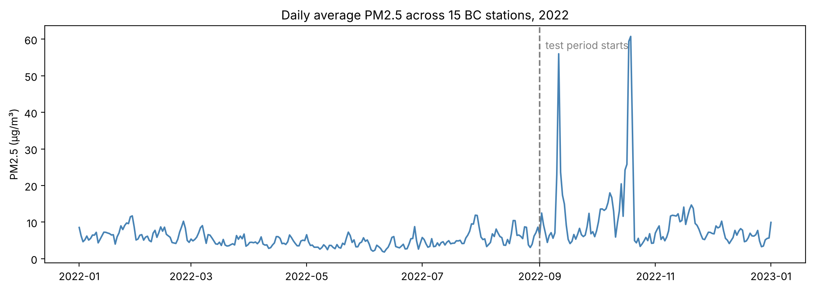
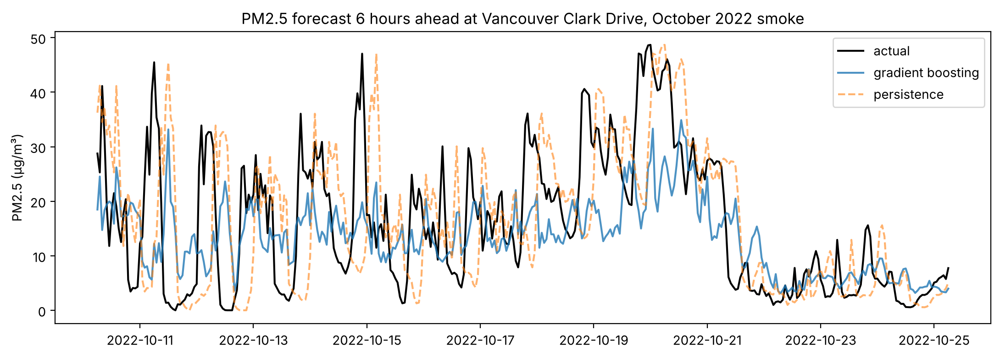

# Forecasting PM2.5 at BC Air Quality Stations

This project forecasts fine particulate matter (PM2.5) six hours ahead at 15 air quality monitoring stations in British Columbia, using hourly readings from 2022. PM2.5 drives most air quality advisories in BC, and it spikes sharply during wildfire smoke. The models are tested on September to December 2022, which includes the fall wildfire smoke, to see how they hold up when air quality changes quickly.

This is a solo rebuild of a CPSC4810 team project, focused on the forecasting question the team version left open.



## Results

| Model | MAE (µg/m³) | RMSE | R² |
| --- | --- | --- | --- |
| Persistence baseline | 5.09 | 10.64 | 0.60 |
| Ridge regression | 4.87 | 10.82 | 0.59 |
| Gradient boosting | 4.84 | 10.39 | 0.62 |

- **Gradient boosting beat the baseline by about 5%** at six hours ahead. The baseline predicts that PM2.5 will stay the same as it is now.
- **Persistence is hard to beat at short horizons.** At one and three hours ahead the baseline won, and the model only pulled ahead from six hours onward, with the biggest gain at 12 hours (about 12% lower MAE).
- **Most of the error comes from smoke.** Error was about five times higher in hours above 25 µg/m³ than in normal hours. Persistence repeats each spike six hours late, and the model's smoother forecast stays below the peaks.
- **Recent PM2.5 carries almost all of the signal.** The current reading and the 24-hour average mattered most. Wind, humidity and time flags added very little, since readings from one station can't see smoke coming.



| Hours ahead | Baseline MAE | Model MAE | Improvement |
| --- | --- | --- | --- |
| 1 | 2.18 | 2.32 | -6.3% |
| 3 | 3.78 | 3.86 | -2.2% |
| 6 | 5.09 | 4.84 | 4.8% |
| 12 | 6.42 | 5.68 | 11.6% |
| 24 | 6.94 | 6.35 | 8.5% |

## Approach

- **Features** include PM2.5 lags (1, 2, 3 and 24 hours), 3-hour and 24-hour rolling averages, NOx, CO, temperature, humidity, wind, cyclical hour and month encoding, and rush hour and weekend flags. All lags are computed within each station.
- **Time-based split** trains on January to August and tests on September to December, so the model never sees the future during training.
- **Predicting the change** in PM2.5 instead of the level. Tree models can't predict values above their training range, and the October smoke pushed readings past 340 µg/m³ when the training maximum was about 163.
- **Persistence baseline** as the benchmark every model has to beat.

## Data

Hourly air quality and meteorological readings for 2022 come from the [BC Ministry of Environment's Verified Hourly Air Quality and Meteorological Data](https://catalogue.data.gov.bc.ca/dataset/77eeadf4-0c19-48bf-a47a-fa9eef01f409) in the BC Data Catalogue. The notebook uses `merged_df.csv`, which combines the separate pollutant and weather files into one row per station per hour for the 15 stations with a full year of readings. The data files are not included in this repository because of their size.

## Running it

```bash
pip install -r requirements.txt
jupyter notebook pm25_forecast.ipynb
```

Place `merged_df.csv` in the same folder as the notebook before running it.

## Next steps

- Add weather or smoke forecasts as features, since past readings can't predict when smoke will arrive
- Use readings from nearby or upwind stations, which may show smoke before it reaches a station
- Compare stations and regions to see where forecasting is hardest
